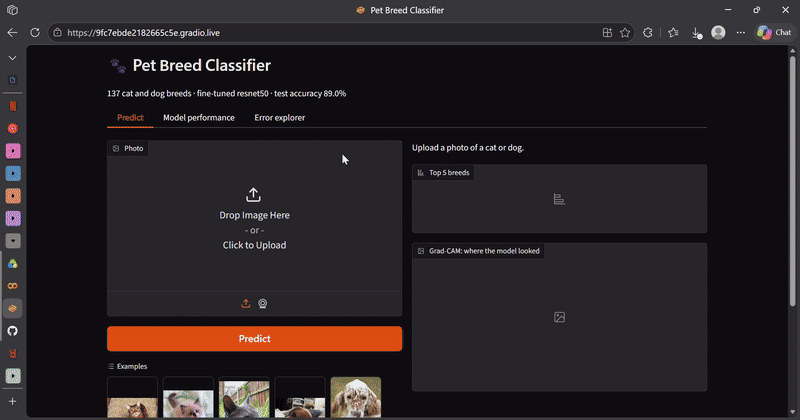
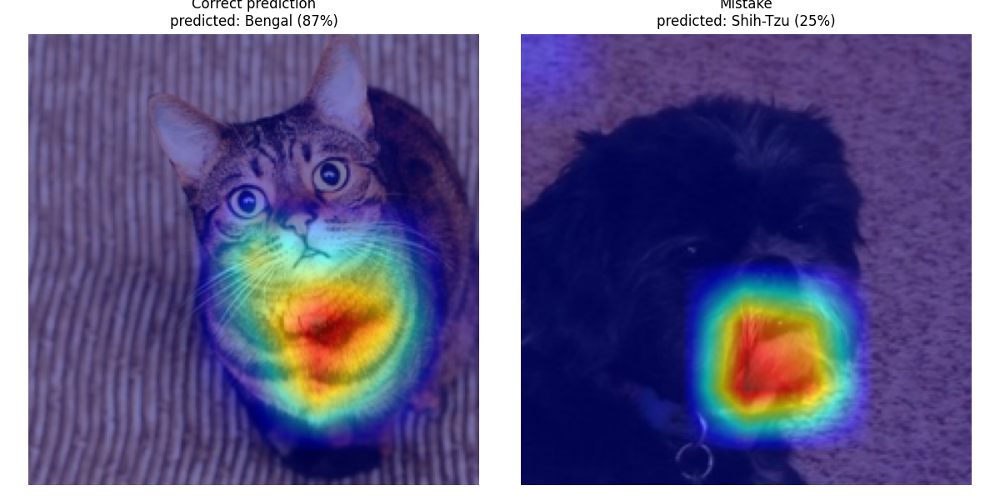

# 🐾 Pet Breed Classifier

Fine-tuned ResNet-50 that identifies **137 cat and dog breeds** from a photo, including breeds common in
India such as the Shih Tzu, Labrador and Indian Pariah (Indie) dog. It shows Grad-CAM explanations, says
"not confident" for non-pet or unfamiliar images, and includes an interactive error-analysis dashboard.



## Results

Evaluated **once** on a held-out test set (3,784 images, 15% of the data, stratified by breed).

| Model | Test accuracy | Top-5 | Macro F1 |
|---|---|---|---|
| Frozen EfficientNet-B0 (baseline) | 74.5% | n/a | n/a |
| **Fine-tuned ResNet-50 (final)** | **89.0%** | **98.5%** | **0.885** |

Accuracy on cats: 94.4% · dogs: 88.5%

**By image source:**

| Source | Test images | Accuracy | Top-5 |
|---|---|---|---|
| Oxford-IIIT Pet | 915 | 93.8% | 99.2% |
| Stanford Dogs | 2,853 | 87.7% | 98.3% |
| Indian Pariah (Indie) | 16 | 62.5% | 93.8% |

Stanford Dogs images come from ImageNet, which the backbone was pretrained on, so their score could be
optimistic. In practice they score *lower* than Oxford images, because Stanford's 120 dog breeds include
many near-identical breeds.

<details>
<summary>Validation comparison used for model selection</summary>

| Run | Backbone | Frozen | Augmentation | Val acc | s/epoch (T4) | Size |
|---|---|---|---|---|---|---|
| Baseline | EfficientNet-B0 | Yes | No | 75.50% | 120 | 17.0 MB |
| Fine-tuned | EfficientNet-B0 | No | Yes | 87.71% | 167 | 17.0 MB |
| Fine-tuned | ResNet-50 | No | Yes | 88.66% | 209 | 95.5 MB |

</details>

## Versions

| Version | Breeds | Images | Test accuracy | Why |
|---|---|---|---|---|
| v1 | 37 | 7,349 | 92.5% | Oxford-IIIT Pet only |
| **v2** | **137** | **25,216** | **89.0%** | Added Stanford Dogs and Indie photos after v1 failed on common Indian breeds |

v1 predicted a Shih Tzu as a Havanese (67%) because Shih Tzu was not one of its breeds. v2 predicts it
correctly at 95%. Accuracy is lower in v2 because the task is much harder (137 breeds instead of 37),
but the model covers the breeds real users actually have. v1 is preserved in the `v1_37_breeds` release.

## Approach

- **Data:** Oxford-IIIT Pet (37 breeds) + Stanford Dogs (120 breeds) + 101 Indian Pariah photos collected by hand. 21 breeds present in both public datasets were merged into one class each, broken images and exact/near-duplicate photos were removed (MD5 + perceptual hash), and each breed was capped at 250 images. Split 70/15/15 into train/val/test, **stratified by breed**, with a fixed seed. Indie photos were split by dog, so no dog appears in two splits.
- **Baseline:** EfficientNet-B0 pretrained on ImageNet, backbone frozen, new linear head (effectively logistic regression on pretrained features).
- **Fine-tuning:** all layers unfrozen, train-only augmentation (random resized crop, horizontal flip, colour jitter without hue), AdamW with a 10× lower learning rate for the backbone than the head, cosine schedule, label smoothing 0.1, early stopping.
- **Model selection on validation:** ResNet-50 was chosen only if it beat EfficientNet-B0 by more than 0.5 points, since it is 5.6× larger.
- **App:** a Gradio dashboard with live prediction, Grad-CAM, per-breed metrics and an error explorer. All metrics and plots are precomputed, so the app only runs single-image CPU inference (~1.4 s including Grad-CAM).

## Error analysis

| True breed | Predicted as | Test images |
|---|---|---|
| Shih-Tzu | Lhasa | 9 |
| Siberian Husky | Eskimo Dog | 7 |
| Toy Poodle | Miniature Poodle | 6 |
| Miniature Poodle | Toy Poodle | 5 |
| Eskimo Dog | Siberian Husky | 5 |

The biggest confusions are between closely related breeds that are hard to tell apart even for people:
Shih Tzus and Lhasa Apsos both have long facial hair, Siberian Huskies and Eskimo Dogs share coat and build,
and the three poodle sizes differ mainly in size, which a single photo cannot show. Cats score higher than
dogs in v2 because the dog classes now include all 120 Stanford breeds, many of them near-identical.



For the correct prediction, the heatmap is centred on the animal's face, around the eyes and muzzle. For the Shih-Tzu → Lhasa mistake, it focuses on the long hair around the dog's face, the feature both breeds share, which explains why they are easily confused.

## Confidence levels

The app uses three confidence levels. Below **40%**, it says the image might not be a cat or a dog: all
28/28 non-pet test photos scored below this. Between **40% and 50%**, it warns that the photo might be
unclear (or a mixed or unsupported breed) and shows the top 3 guesses. Above **50%**, it shows the breed.
For reference, the threshold tuned on validation to reject at most 5% of correct predictions was **0.45**
(it wrongly rejects 3.7% of correctly classified test pets).

## Limitations

- Knows **only these 137 breeds**: mixed breeds and other breeds get the closest-looking match.
- The confidence check is **approximate**: softmax always spreads 100% across the 137 breeds and has no "none of these" option, so a dog-like object (a plush toy, a fox) can still get a confident wrong answer.
- Indie has only 101 photos (16 in the test set), so its accuracy is noisy, and the photos come from Pinterest, so they are not included in this repo.
- Trained mostly on curated dataset photos; real phone photos (blur, odd angles, several animals) may score lower.
- There is no public live demo: Hugging Face's free tier no longer hosts CPU Gradio apps, so the app runs locally (see below). It will be served through Shiro's backend.

## Run locally

```bash
git clone https://github.com/piihutanoch/pet-breed-classifier
cd pet-breed-classifier
pip install -r requirements.txt

# Model weights are attached to the v2 GitHub release, not stored in the repo
wget -O artifacts_v2/model.pt https://github.com/piihutanoch/pet-breed-classifier/releases/download/v2_137_breeds/model.pt

python app.py
```

## Repository structure

```
notebooks/     01_eda · 01b_eda_build_dataset · 02_baseline · 03_finetune · 04_evaluate · 05_app_dev · 06_package
src/           data.py (transforms) · data_v2.py (manifest loader) · model.py · predict.py · gradcam.py
artifacts_v2/  metrics, per-class and per-source results, confusion matrix, confused pairs, error examples
app.py         Gradio dashboard
results.md     experiment log (v1 and v2)
```

**Stack:** Python · PyTorch · torchvision · scikit-learn · pytorch-grad-cam · Gradio
